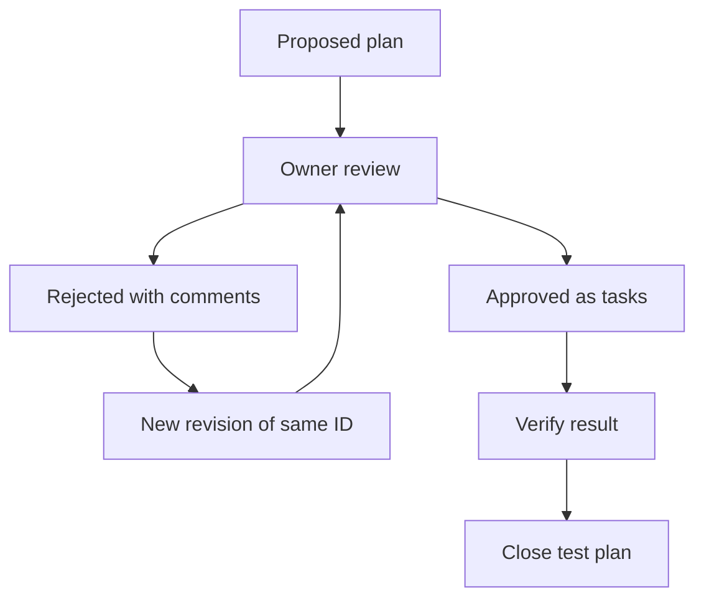

# Manual test — review workflow

## Objective
Validate opening, persistent comment, rejection, revision with the same ID, Mermaid rendering, approval, and closure in DSH TUI.

## Safe scope
- This is a test artifact separated from existing plans.
- Do not edit code, install packages, or alter other tasks.
- Approving this plan authorizes only the checks described below.

## Expected result
Workflow validated by owner, with harness evidence and visual confirmation in TUI.

## Feedback incorporated in this revision
- Received comment “teste na linha 20” ("test on line 20"), associated with the comment persistence criterion in the previous revision.
- Received line 23 comment requesting a Mermaid diagram; included below.
- The harness confirmed rejection of revision 1 without execution authorization. Persistence via Esc still depends on owner confirmation.
- Revision 1 comments must remain in history with their original anchors, without being automatically re-associated with this revision.

## Diagram for visual validation
The block below must appear as a diagram in the native TUI renderer. Displaying only source code or a fallback message does not confirm graphical rendering of this example.

## Execution after approval
1. Read this plan and confirm approved revision and its feedback.
2. Ask owner for confirmation of navigation, draft persistence after Esc, comment history, and Mermaid rendering.
3. Record evidence and close only this test plan when owner confirms the result.

## Acceptance criteria
- Saved comment survives Esc and reopening, without being sent before rejection.
- Rejecting sends the comment, but does not authorize execution.
- Revision maintains ID, increments revision, and requires new approval.
- Old comments remain linked to original revision and lines.
- Mermaid above is rendered as a legible diagram in TUI.
- Approving as tasks authorizes only the scope of this test.
- Closure preserves content and history in .plan/closed/.
